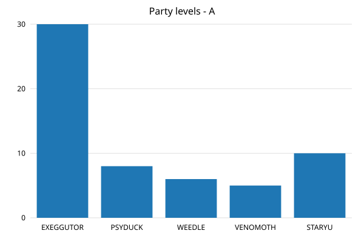
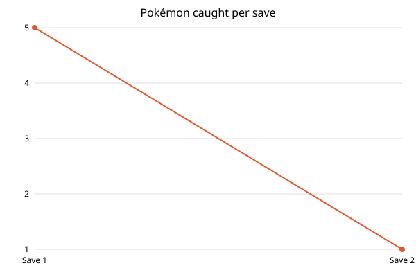

# Save Stats

An application for people who play Pokémon Red, Blue or Yellow. Give it one or more save files,
pick the charts you want, and see them as an HTML report. Use it in the terminal, where you pick
charts from a menu and save the report as a file, or start it with `--web` and do everything in
your web browser.

<p>
  
  
</p>

## Vision

Players of the first Pokémon games should be able to see how strong their team is, how far their
Pokédex has come and how their game has progressed between saves – as charts, without reading
numbers off the game's menus.

## Requirements

| ID | Requirement |
|---|---|
| R1 | The user starts the application with one or more save files and sees which were loaded, with the trainer's name. |
| R2 | The user can add a bar chart of the party's levels to the report. |
| R3 | The user can add a bar chart of one chosen Pokémon's stats, or of its IVs. |
| R4 | The user can add a chart of the Pokédex progress: caught, seen but not caught, and not seen, out of 151. |
| R5 | With two or more saves, the user can add line charts of Pokémon caught and badges per save. |
| R6 | The user can change the color of the charts and save the report as an HTML file. |
| R7 | A missing, unreadable or invalid file, or an invalid answer in the menu, gives a clear message instead of a crash. The other files are still loaded. |
| R8 | Started with `--web`, the user chooses save files, charts and a color on a page in the web browser and sees the charts on the next page. |
| R9 | In the web browser, an invalid or too large file, or a choice that is missing, gives a page with a clear message instead of a crash. |

All requirements are implemented. How they were tested is described in
[TEST_REPORT.md](TEST_REPORT.md).

## Getting started

### Requirements

- **Java 25** or later. Check with `java -version`. An older Java gives the error
  `UnsupportedClassVersionError`.
- A save file from Pokémon Red, Blue or Yellow (`.sav` or `.srm`, exactly 32,768 bytes), for
  example from an emulator. No game of your own? Use the files in [samples/](samples/).

### Download and run

1. Download `save-stats-1.1.0.jar` from the
   [latest release](https://github.com/Robert060615/Save-Stats/releases/latest).
2. Open a terminal in the folder where the file is and run it with your save files, oldest first:

   ```bash
   java -jar save-stats-1.1.0.jar my-game.sav
   java -jar save-stats-1.1.0.jar monday.sav friday.sav
   ```

   Or start it in the web browser instead, see [In the web browser](#in-the-web-browser):

   ```bash
   java -jar save-stats-1.1.0.jar --web
   ```

### Or build it yourself

```bash
git clone https://github.com/Robert060615/Save-Stats.git
cd Save-Stats
./gradlew :app:fatJar
java -jar app/build/libs/save-stats-1.1.0.jar samples/yellow-2.srm samples/yellow-3.srm
```

On Windows, use `gradlew.bat` instead of `./gradlew`.

## Using the application

### In the terminal

When the files are loaded, a menu is shown. Type a number and press Enter.

```text
Save 1: yellow-2.srm (trainer A)
Save 2: yellow-3.srm (trainer YELLOW)

What do you want to do?
  1) Add chart: party levels
  2) Add chart: stats of one Pokémon
  3) Add chart: IVs of one Pokémon
  4) Add chart: Pokédex progress
  5) Add charts: progress between saves
  6) Change chart color
  7) Save report and quit
  8) Quit without saving
Choose 1-8: 1
Which save?
  1) yellow-2.srm
  2) yellow-3.srm
Choose 1-2: 1
Added "Party levels - A" to the report.
```

| Choice | What you get |
|---|---|
| Party levels | One bar per Pokémon in the party, showing its level. |
| Stats of one Pokémon | Max HP, Attack, Defense, Speed and Special of the Pokémon you choose. |
| IVs of one Pokémon | Its individual values (0–15), the hidden values that make two Pokémon of the same kind differ. |
| Pokédex progress | How many of the 151 Pokémon are caught, seen but not caught, and not seen. |
| Progress between saves | Two line charts, Pokémon caught and badges, with one point per save in the order you gave the files. Needs at least two files. |
| Change chart color | A hex color such as `#e4572e`. Charts added after the change get the new color. |

Choose **Save report and quit** when you are done. The report is saved as
`save-stats-report.html` in the folder you ran the command from (an existing file with that name is
replaced), and the full path is printed. Open it in a web browser.

### Good to know

- Give the files **oldest first**. The progress charts label them *Save 1*, *Save 2* … in that
  order; the numbers match the list printed when the files are loaded.
- The progress charts are most useful with saves from **one** game at different times. The files
  in `samples/` come from different games, so they show the charts working but not real progress.
- A save whose party is empty (before you get your first Pokémon) can only be used for the Pokédex
  and progress charts.
- Press **Ctrl+D** (Ctrl+Z then Enter on Windows) to quit at any time without saving.

### In the web browser

```bash
java -jar save-stats-1.1.0.jar --web
```

```text
Save Stats is running at http://localhost:8080
Open it in a web browser. Press Ctrl+C to stop.
```

Open <http://localhost:8080>. On the page:

1. **Save files:** choose one or more files. Hold Cmd (Ctrl on Windows) to choose several. They
   are numbered *Save 1*, *Save 2* … in the order the browser hands them over, which you cannot
   always control. Naming the files so they sort oldest first, for example `1-monday.sav` and
   `2-friday.sav`, makes the order easy to check in the headings.
2. **Charts:** tick the ones you want.
   - *Party levels* and *Pokédex progress* are the same charts as in the terminal.
   - *Stats and IVs for the whole party* draws both charts for every Pokémon in the party.
   - *Progress between saves* can only be ticked when at least two files are chosen.
3. **Color:** pick the color of the bars and lines.
4. Click **Show charts**.

The next page shows the charts for each file in turn, and each heading starts with the file name.
The progress charts come last. To save the page, use your browser's *Save page as*. Press the back
button to try other choices.

If a file is not a valid save, or something is missing, a page explains what went wrong and links
back to the start page. Up to ten save files can be sent at a time.

Good to know:

- The page is only reachable from your own computer. Other people on the network cannot open it.
- Nothing is saved on the computer. The files are only used to draw the charts you asked for.
- Party charts are left out for a save whose party is empty. The Pokédex and progress charts are
  still shown.
- If port 8080 is already in use, the application says so and stops. Close the other program, or
  the other Save Stats, and try again.

## For developers

### How it is built

The application uses two modules, kept as separate projects. Neither of them depends on the
application.

| Module | Used for | Included as |
|---|---|---|
| [svg-charts-module](https://github.com/Robert060615/svg-charts-module) (my own) | Drawing the bar and line charts as SVG | Gradle dependency from JitPack, `v1.1.0` |
| [Pokemon-Red-Blue-Savechecker-Module](https://github.com/Akistolol88/Pokemon-Red-Blue-Savechecker-Module) (Akistolol88) | Reading and validating save files | Copied in unchanged to [vendor/savechecker](vendor/), built as a Gradle subproject |

All application code is in `app/src/main/java/se/lnu/rm222xi/savestats/`:

| Class | Responsibility |
|---|---|
| `App` | Entry point. Creates the objects and starts `SaveStatsApp`, or `WebServer` with `--web`; nothing else. |
| `SaveStatsApp` | Runs one session: loads the files, runs the menu, saves the report. |
| `ConsoleView` | Everything the user sees and types. Asks again until an answer is valid. |
| `MenuOption` | The menu choices, in the order they are shown. |
| `SaveLoader` | Reads a file, or bytes sent from the browser, and turns every kind of failure into one `SaveLoadException`. |
| `GameSave` | The only class that uses the savechecker module's types (besides `SaveLoader`). |
| `ChartBuilder` | Turns save data into charts with svg-charts, in the chosen color. |
| `Report`, `ReportSection` | The HTML page and the charts in it. |
| `InputClosedException` | Thrown when the input ends (Ctrl+D), so the session can stop calmly. |
| `WebServer` | The web mode. Serves the start page and the report on `localhost` with Java's built-in `HttpServer`, and shows error pages. |
| `ReportRequest` | Reads the form data from the start page: the files, the ticked charts and the color. |
| `ChartChoice`, `UploadedSave` | A chart that can be ticked on the start page, and a file sent from it. |
| `WebReportBuilder` | Builds the whole report for one request, with its own `ChartBuilder` and `Report`. |
| `InvalidRequestException` | Thrown when the form data is missing something. The message is shown to the user. |
| `Html` | Escapes text before it is put in a page. |

The start page is `app/src/main/resources/se/lnu/rm222xi/savestats/start-page.html`. Its
JavaScript encodes each file in Base64 and sends it as an ordinary form field, so the server never
has to read `multipart/form-data`. The server remembers nothing between requests.

To add a new chart: add a method to `ChartBuilder` (and to `GameSave` if it needs new data), a
value to `MenuOption`, and a case in `SaveStatsApp.handle`. The compiler points out the missing
case. For the web mode, also add a value to `ChartChoice`, a checkbox with the same value on the
start page, and a line in `WebReportBuilder`.

### Building and testing

| Command | What it does |
|---|---|
| `./gradlew build` | Compiles, runs the unit tests and checks the code with Checkstyle and PMD. |
| `./gradlew :app:test` | Runs the unit tests. A summary is saved to `app/build/reports/test-summary.log`. |
| `./gradlew :app:fatJar` | Builds `app/build/libs/save-stats-1.1.0.jar` with both modules inside. |
| `./gradlew :app:run --console=plain --args="../samples/red.sav"` | Runs from source. Paths are relative to `app/`; `--console=plain` keeps Gradle's progress bar out of the menu. |
| `./gradlew :app:run --args="--web"` | Runs the web mode from source. Stop it with Ctrl+C. |

### Project structure

| Folder | Content |
|---|---|
| `app/` | The application and its unit tests. |
| `vendor/` | The other student's module, unchanged. See [vendor/README.md](vendor/README.md). |
| `samples/` | Save files for trying the application. See [samples/README.md](samples/README.md). |
| `docs/` | The example charts in this README. |
| `config/`, `build-logic/`, `gradle/` | Build, Checkstyle and PMD configuration from the course template. |

## License

Released into the public domain under [the Unlicense](LICENSE).
